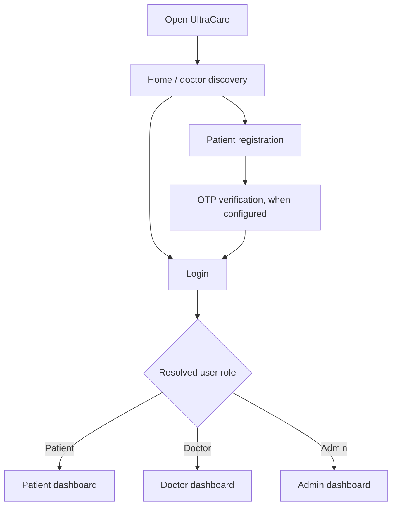
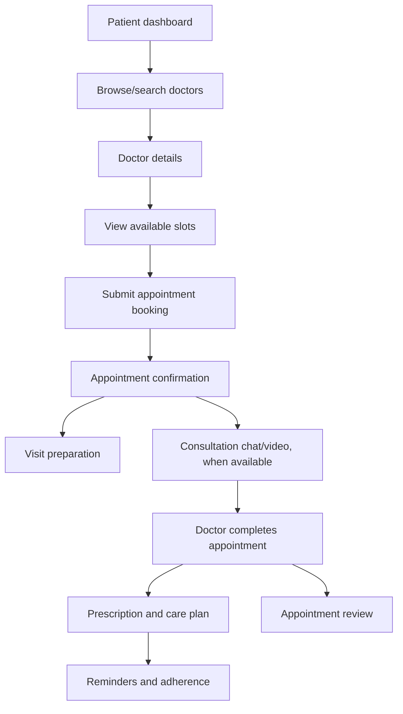
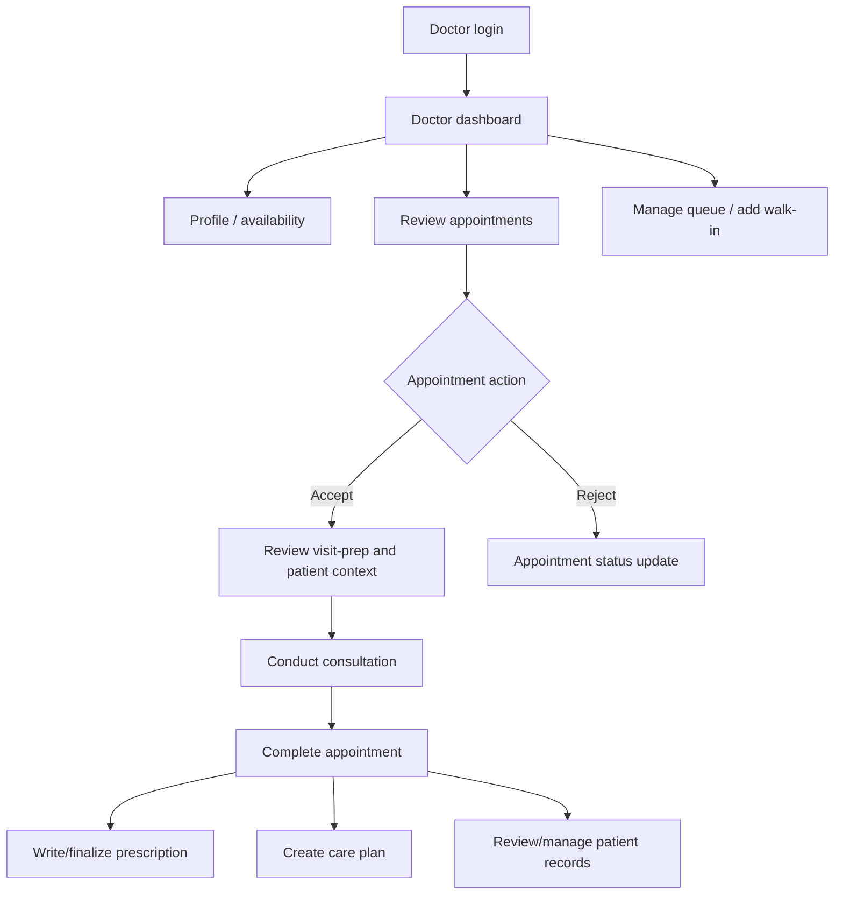
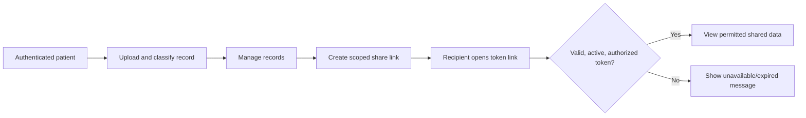
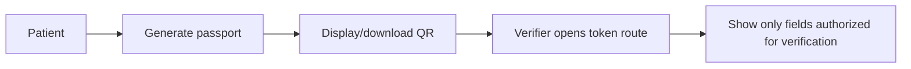
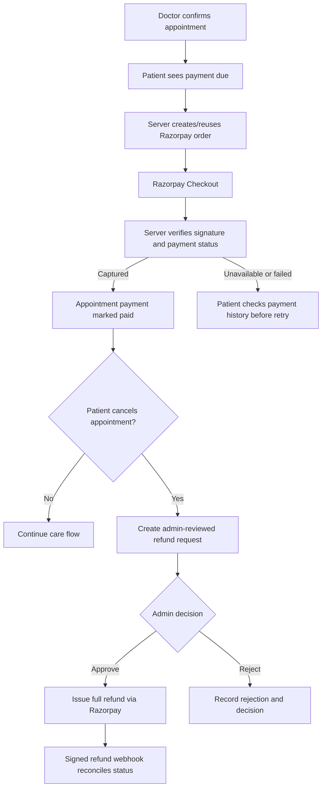
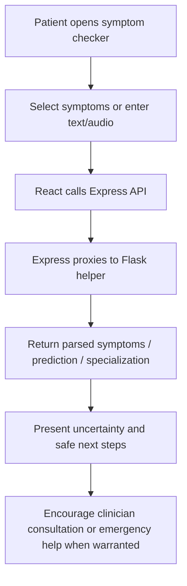
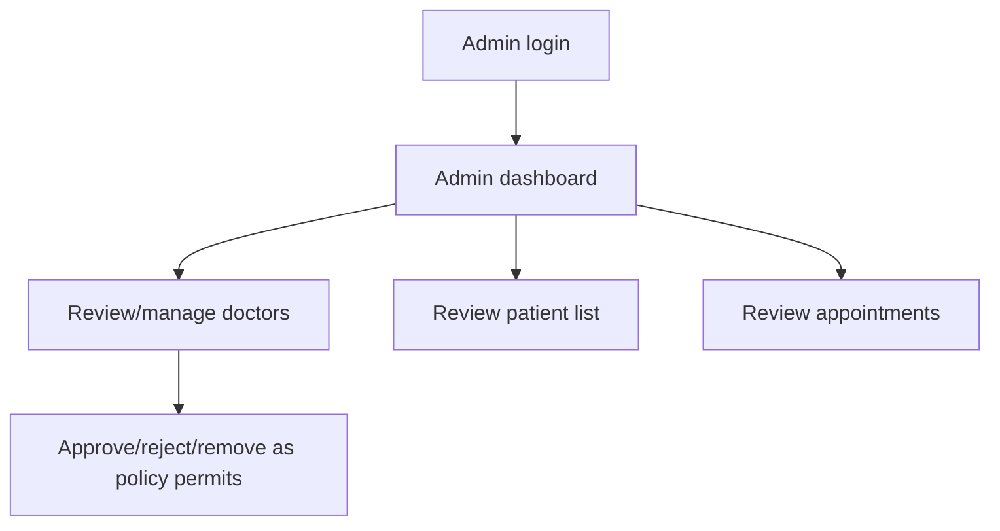

# UltraCare HMS Application Flows

**Status:** Flow map based on current frontend routes and backend route modules. Verify each transition and available integration in code before treating it as production behavior.

## 1. Roles and Entry Points

The application uses a shared auth provider and React protected routes. The backend remains authoritative for access. Confirm registration redirects and unapproved-doctor behavior from the current auth implementation.

## 2. Patient Care Journey

Related routes include patient dashboard/profile, `/doctors`, appointment booking/detail/confirmation, visit prep, consultation chat/video, prescription detail, healing plan, reminders, review, and queue status. Route paths and exact ordering can vary by implementation/state.

## 3. Doctor Journey

Doctor routes include dashboard, profile, appointments, analytics, patient list/records, queue, prep sheet, prescription, care plan, and consultation. Verify exact state transitions and notification behavior in route handlers.

## 4. Health Information Flows

### Health locker sharing

### Health passport

The actual scope, expiry, revocation behavior, and fields exposed by share/passport tokens must be read from `routes/healthLocker.js` and `routes/healthPassport.js` before extending these flows.

### Health tracker and family care

- Patient opens tracker, starts/configures a condition, logs health data, reviews charts/insights, and downloads a report.
- Patient adds/edits a family member, views that member's vaccination schedule, and records a vaccination event.
- Patient reviews allergies, preventive-care tasks, reminders, and care-plan adherence.

Keep patient-owned versus family-member data explicit in navigation and confirmation messages.

## 5. Appointment Payment and Refund Flow

The patient-facing UI displays payment/refund history. The payment amount is sourced from the persisted appointment, not the browser. Refund approval currently means a full refund; cancellation cutoffs and partial refund policy require product-owner approval.

## 6. Symptom Assistance Flow

This is decision support, not diagnosis. Handle helper unavailability without losing the user's input. Verify the app's emergency copy against clinical/product review before changing it.

## 7. Emergency and Queue Flow

- Patient opens the ambulance workflow and submits a request; the UI should show the server-returned status and any supported cancellation action.
- Patient opens appointment queue status to see their own position/status.
- Doctor views the queue and can add walk-ins or update the queue through authorized actions.
- Public queue data, if exposed, must not reveal identifiable patient details.

The presence of ambulance booking endpoints does not by itself establish a real-world dispatch integration.

## 8. Administrator Flow

Confirm audit history, data visibility, and approval rules from current policy/code; restrict administrative data to authorized admins.

## 9. Common Error and Recovery Paths

- **Unauthenticated session:** Preserve a safe return destination if supported; require login before retrying protected actions.
- **Wrong role or no ownership:** Deny on the server and show a non-disclosing error state.
- **Validation conflict:** Keep safe user input and explain what must be corrected.
- **Slot conflict:** Refresh availability and ask the patient to select another slot.
- **Network/service failure:** Preserve form state where possible, provide retry, and do not claim a request succeeded.
- **Expired share/verification token:** Explain that access is no longer available without exposing private data.
- **ML/OCR/integration unavailable:** Keep manual entry/review available where feasible and label fallback behavior.
- **Payment callback/webhook delayed:** Show a pending/recheck state; never ask the patient to pay again until payment history is checked.
- **Refund provider failure:** Keep the refund state visible to administrators for review/retry; do not claim funds have been returned until the provider confirms it.

## 10. Flow Implementation Reference

- React routes and role groupings: `client/src/App.jsx`
- Auth and roles: `routes/auth.js`, `middleware/auth.js`, `client/src/context/AuthContext` (confirm exact file)
- Appointment/doctor/patient: `routes/patient.js`, `routes/doctor.js`
- Consultation: `routes/consultation.js`
- Prescription and care plan: `routes/prescription.js`, `routes/carePlan.js`
- Health locker/passport/tracker: `routes/healthLocker.js`, `routes/healthPassport.js`, `routes/healthTracker.js`
- Emergency/queue: `routes/ambulance.js`, `routes/queue.js`
- Payments/refunds: `routes/payments.js`, `models/Payment.js`, `services/paymentService.js`
