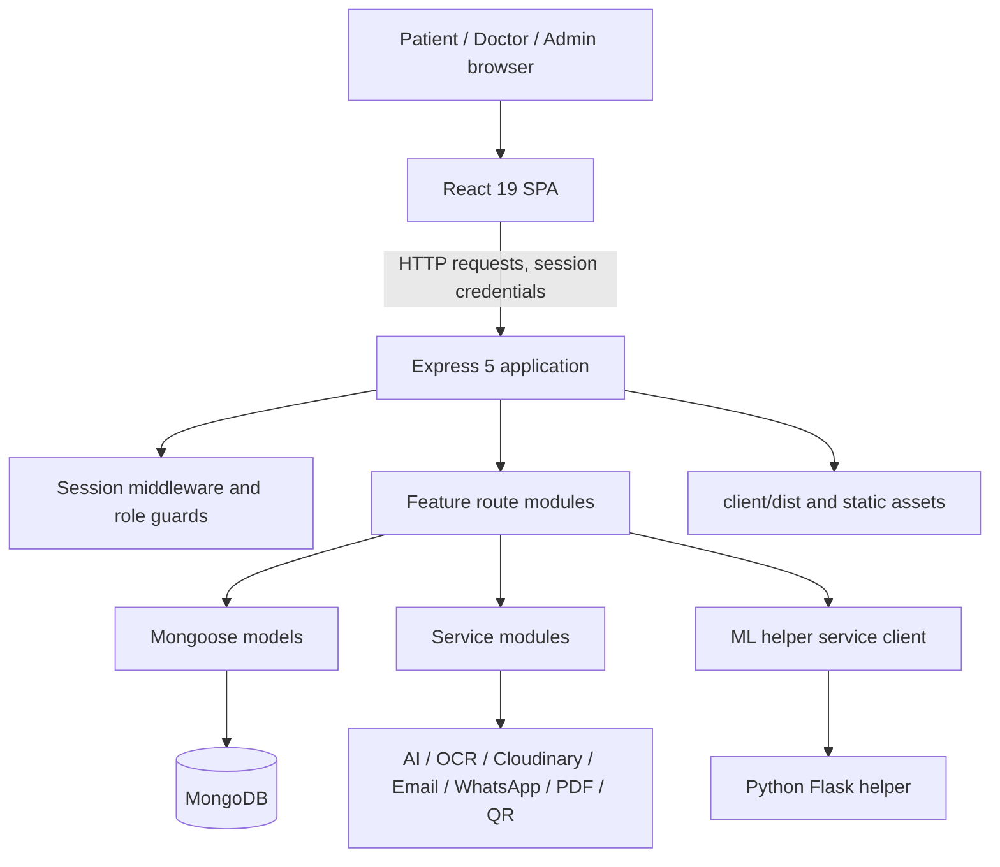

# UltraCare HMS Architecture

**Status:** Current-state architecture overview based on repository structure. This is not a deployment diagram or security certification; verify environment-specific details before operational use.

## 1. Architectural Overview

UltraCare is a web application with a React SPA, an Express API, MongoDB persistence through Mongoose, and an optional Python Flask helper for ML-related requests. The backend also owns integration boundaries for email, messaging, cloud media, OCR, PDF, QR, and generative-AI workflows.

## 2. Repository Boundaries

| Area | Responsibility |
|---|---|
| `client/src/` | React app shell, route definitions, pages, shared components, auth context, styles, and theme |
| `server.js` | Express setup, middleware, session store, route mounting, health endpoint, static/SPA serving, startup |
| `routes/` | HTTP endpoints and feature workflows, including auth, patient, doctor, admin, appointments, records, health, consultation, prescription, queue, and related domains |
| `middleware/` | Authentication and role checks |
| `models/` | Mongoose schemas and persistence entities |
| `services/` | External integrations and business-service boundaries such as email, OCR, ML, PDF, prescription, and storage |
| `config/db.js` | MongoDB connection setup |
| `ml_server.py`, `ml/` | Flask helper, prediction/parse workflows, training and ML assets |
| `static/` | Server-served static content and uploads (inspect access controls before using for sensitive files) |
| `scripts/`, `TESTING.md` | Utility and documented focused test scripts |
| `archive/` | Archived project materials; do not assume these are active application code |

## 3. Runtime and Request Lifecycle

1. `server.js` loads environment configuration and constructs the Express application.
2. It creates upload directories, configures request parsing, CORS, static serving, session middleware backed by MongoDB, and template compatibility.
3. Route modules are mounted beneath `/api`.
4. A request enters a feature router, passes the relevant auth/role middleware, validates inputs, performs model/service work, and returns JSON.
5. The frontend calls the API and renders the result through React routes and shared auth state.
6. On startup, MongoDB connects first; the ML helper is then started on a best-effort basis. The server serves `client/dist` in production and exposes `/health`.

The actual server also configures EJS, so route/template legacy behavior may coexist with the SPA. Verify the active path before changing rendering or redirects.

## 4. API Module Map

| Domain | Route modules |
|---|---|
| Home, testimonials, symptom/traffic ML proxies | `routes/index.js` |
| Registration, login, OTP, password flows | `routes/auth.js` |
| Patient profiles, doctor discovery, booking, reminders, notifications, reviews | `routes/patient.js` |
| Doctor profiles, appointments, records, analytics, availability | `routes/doctor.js` |
| Admin oversight | `routes/admin.js` |
| Chat/video consultation | `routes/consultation.js` |
| Prescriptions, OCR, checks, PDFs, verification, translation | `routes/prescription.js` |
| Care plans and adherence | `routes/carePlan.js` |
| Health tracker/reports | `routes/healthTracker.js` |
| Health locker and share links | `routes/healthLocker.js` |
| Health passport and verification | `routes/healthPassport.js` |
| Allergies and overrides | `routes/allergy.js` |
| Family and vaccination | `routes/family.js` |
| Ambulance bookings | `routes/ambulance.js` |
| Queue and walk-ins | `routes/queue.js` |
| Preventive care | `routes/preventive.js` |
| Visit preparation | `routes/visitPrep.js` |
| Scheduled/background endpoints | `routes/cron.js` |

All modules above are mounted with `/api` in `server.js`; check individual router paths for full endpoint paths and middleware.

## 5. Data Model Domains

Mongoose models include:

- **Identity and access:** `Patient`, `Doctor`, `Admin`, `OtpSession`
- **Appointments and communication:** `Appointment`, `ChatMessage`, `QueueEntry`, `Review`, `Notification`
- **Clinical follow-up:** `Prescription`, `CarePlan`, `CarePlanItem`, `AdherenceLog`, `VisitPrepSheet`
- **Patient health information:** `HealthLog`, `HealthTrackerConfig`, `HealthRecord`, `MedicalReport`, `HealthPassport`, `ShareLink`, `PatientAllergy`, `DrugAllergyOverride`, `ScreeningRecord`
- **Family and medication support:** `FamilyMember`, `VaccinationLog`, `MedicineReminder`
- **Operations:** `AmbulanceBooking`, `Testimonial`

Read each schema before relying on field names, references, indexes, or lifecycle rules. Route maps and model names do not fully specify data retention or access policy.

## 6. Frontend Architecture

- `client/src/App.jsx` registers public and role-protected routes.
- `AuthProvider` supplies session/user state; `ProtectedRoute` checks allowed roles for UX-level route protection.
- `Navbar` and `Footer` wrap routed content.
- Pages are separated under `client/src/pages/`; shared components, styles, context, and theme are separate areas.
- Backend authorization is mandatory even when a page is protected in React.
- The SPA uses Vite in development and is built to `client/dist` for Express production serving.

## 7. Integration Architecture

- **ML helper:** Node starts/proxies to Flask through `services/mlHelperService.js`; `routes/index.js` exposes selected proxy endpoints. Flask contains symptom processing/prediction and traffic-density prediction. Treat ML output as assistive, not definitive.
- **OCR/prescriptions:** OCR and AI-assisted prescription logic are separated into services and prescription routes; maintain human review and validation.
- **Storage/media:** Cloudinary integration exists; local static upload directories also exist. Confirm which storage path each feature uses and whether files are private.
- **Communication:** Email and WhatsApp/Twilio service modules exist; inspect configuration and failure handling before promising delivery.
- **Document output:** PDF and QR generation are handled by existing service/package boundaries.

### Payment processing

Razorpay Checkout is launched by the patient dashboard only after the appointment is confirmed. The backend creates an order from the appointment's saved fee, records provider order/payment identifiers in `Payment`, verifies the checkout signature, and fetches/captures provider state before updating `Appointment.payment_status`. The browser never supplies the amount used to create the order.

Signed webhook requests use the raw request body captured in `server.js`. `routes/payments.js` reconciles captured payments and refund outcomes; `services/paymentService.js` validates signatures and creates the provider client. Paid appointment cancellation creates an admin review request. Admin approval requests a full refund, and the appointment is marked refunded only after provider confirmation.

## 8. Security and Trust Boundaries

- Browser input is untrusted; validate at the API boundary.
- Session identity is untrusted until resolved by backend middleware.
- A valid role does not imply ownership of a specific appointment, record, prescription, or conversation; check both.
- Tokens in URLs are bearer credentials. Scope, expiry, revocation, redaction, and access logging should be explicit.
- Uploaded files are untrusted; validate content, type, size, and storage access.
- Third-party and ML responses are untrusted; validate shape and render safely.
- Logs and error responses must not reveal secrets or unnecessary health information.

Production readiness requires review of session cookie settings, secrets, rate limits, file isolation, CORS, auditability, backups, retention, and incident handling. Do not imply regulatory compliance without a formal assessment.

## 9. Deployment and Operations

Known local commands:

- Backend: `node server.js`
- Frontend dev: `npm run dev --prefix client`
- Frontend build: `npm run build --prefix client`
- Frontend lint: `npm run lint --prefix client`
- Python dependency set: `requirements.txt`

The backend defaults to port `3000`; `client/dist` is used for production SPA serving. MongoDB URI is read from `MONGO_URI`; other configuration values must be discovered from actual environment references. The server's health endpoint reports server and database state. Define a deployment-specific strategy for process supervision, secrets, backups, migrations, observability, TLS, and the Flask process.

## 10. Known Architecture Risks and Follow-up

- Session cookie hardening and production secret handling need environment-specific verification.
- The API error handler currently returns an error response; review production-safe error shaping before deployment.
- Local and cloud upload storage can create inconsistent privacy/retention behavior if not made explicit.
- The client contains duplicate/alias route patterns; preserve expected navigation while consolidating only through an intentional change.
- Feature-specific authorization must be audited route by route; route-level authentication alone may not guarantee object ownership.
- The root test script is a placeholder. Build a repeatable, isolated API/UI test suite before relying on CI gates.
- Optional third-party/ML services need health, timeout, failure, and user-facing fallback behavior.
- Razorpay credentials and webhook secret must be set in the runtime environment; configure a public HTTPS webhook URL and test-mode events before end-to-end testing.
- The implemented refund decision is full refund after admin approval; define cancellation cutoffs, partial refund rules, operational ownership, and refund timing before enabling live payments.
- Payment endpoints have not been verified against a configured provider account in this workspace; run test-mode checkout and webhook replay tests before release.
