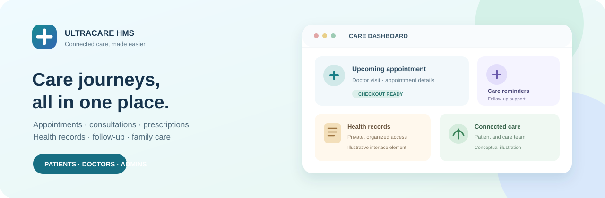
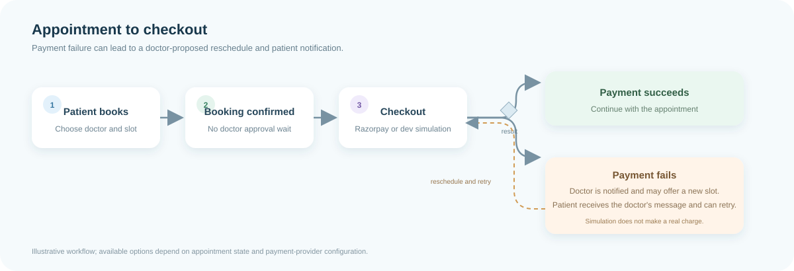
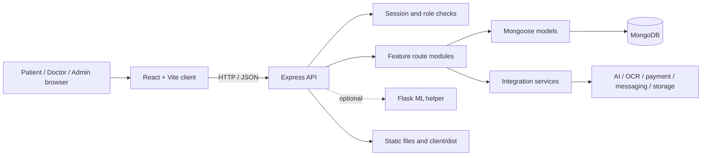

# UltraCare HMS

UltraCare is a web-based healthcare management system for patients, doctors, and administrators. It brings doctor discovery, appointments, consultations, prescriptions, care plans, personal health records, and ongoing health-management workflows together in one application.

> **Clinical and emergency safety:** UltraCare is a software project, not a medical device or emergency dispatch service. AI, OCR, symptom, and recovery outputs are assistive and must not replace clinical judgment. Doctors must verify extracted prescription details against the original. An ambulance request in the app does not guarantee that emergency services are dispatched.



*Conceptual illustration created for this README; it is not a screenshot of the live application.*

## Contents

- [Product overview](#product-overview)
- [Illustrated workflows](#illustrated-workflows)
- [Features](#features)
- [Technology and architecture](#technology-and-architecture)
- [Repository structure](#repository-structure)
- [Requirements](#requirements)
- [Run locally](#run-locally)
- [Configuration](#configuration)
- [Build, lint, and tests](#build-lint-and-tests)
- [Deploy to Render](#deploy-to-render)
- [Privacy, security, and clinical limitations](#privacy-security-and-clinical-limitations)
- [Project documentation](#project-documentation)

## Product overview

The application has separate experiences for patients, doctors, and administrators. The React client provides the web interface; the Express server exposes API routes and serves the production client; MongoDB stores application data. A Python/Flask helper is optional and supports selected ML workflows.

| User | Example workflows |
|---|---|
| Patient | Find doctors, book an appointment, complete payment, message the doctor, view prescriptions, manage health records, track health, and coordinate family care |
| Doctor | Manage a profile and schedule, review patient context, conduct consultations, create prescriptions and care plans, manage queues, and review analytics |
| Administrator | Review platform accounts and appointments and handle eligible payment-refund requests |

## Illustrated workflows

### Appointment and payment

Appointments are booked immediately and lead to checkout. When Razorpay is not configured, the development payment simulation can represent success or failure without charging money. A failed payment notifies the doctor, who can offer a new slot and send a message for the patient.



*Conceptual workflow illustration. Available actions depend on account role, appointment state, and provider configuration.*

## Features

### Patient experience

- Register, sign in, manage a profile, and discover doctors.
- Book appointments without waiting for doctor approval, then proceed to checkout.
- Use Razorpay when configured, or the clearly labeled local demo-payment simulation during development.
- Review appointment updates and request rescheduling; receive doctor messages about a replacement time after payment failure.
- Access prescriptions and care instructions shared by a doctor.
- Manage health records in Health Locker, share records through supported links, and export record metadata and structured prescription data as JSON.
- Track health, manage allergies, maintain family-member and vaccination details, and review care plans and reminders.
- Prepare for visits, participate in consultations, and use queue, health-passport, preventive-care, and symptom-assistance workflows where available.
- Choose English, Hindi, or Marathi for supported AI-assisted prescription summaries. The rest of the interface is currently English.

### Doctor experience

- Manage a doctor profile, appointment availability, and patient appointments.
- Review relevant patient information and appointment follow-up messages.
- Reschedule appointments after a failed payment and send the patient a message with the new time.
- Use consultation, queue, and visit-preparation tools.
- Create prescriptions by uploading a PDF/image for assisted medicine extraction, or enter medicines manually.
- Review and verify every extracted medicine name and instruction against the original prescription before sharing.
- Create care plans and review analytics such as appointment activity, ratings, revenue, cancellations, reschedule requests, and upcoming follow-ups.

### Administrator and shared tools

- Admin workflows for platform account and appointment oversight, including eligible refund requests.
- Appointment and medicine reminders, reports, visit preparation, health passports, and scoped health-record sharing.
- Accessibility controls for larger text and high contrast, a keyboard-accessible skip link, and visible focus indicators.

## Technology and architecture

| Layer | Technologies |
|---|---|
| Web client | React 19, React Router, Vite, Material UI, Axios, Lucide, and Chart.js |
| API server | Node.js, Express 5, session middleware, and Mongoose |
| Database | MongoDB |
| Optional ML service | Python, Flask, and scikit-learn |
| Optional integrations | Razorpay, email, SMS/WhatsApp, Cloudinary, OCR/AI, PDF, and QR tooling |



In development, Vite proxies `/api` and `/static` requests to the Express server on port `3000`. In production, Express serves the Vite build from `client/dist`. Backend authorization and ownership checks are required even when a client page is protected by a role guard.

## Repository structure

```text
client/                 React application, pages, components, and Vite configuration
config/                 Database configuration
middleware/             Authentication and role middleware
models/                 Mongoose schemas
routes/                 API route modules
services/               Payment, prescription, OCR, email, ML, and other services
static/                 Static application assets and runtime upload locations
scripts/                Focused API and prescription checks
ml/                     ML support data
docs/images/             README illustrations
server.js               Express application entry point
ml_server.py            Optional Flask helper
package.json            Backend dependencies and root commands
client/package.json     Frontend dependencies and client commands
requirements.txt        Python helper dependencies
render.yaml             Render Blueprint configuration
```

User uploads and generated clinical documents are runtime data, not README assets. Do not copy patient files or private health information into documentation or source control.

## Requirements

- Node.js and npm versions supported by the installed project dependencies.
- A reachable MongoDB instance (local MongoDB or MongoDB Atlas).
- Python and pip only if you intend to run the optional ML helper.
- Provider accounts/credentials only for the external integrations you plan to use.

## Run locally

The commands below use PowerShell syntax.

1. **Install dependencies** from the repository root:

   ```powershell
   npm ci
   npm ci --prefix client
   ```

2. **Create your local environment file** from the example:

   ```powershell
   Copy-Item .env.example .env
   ```

   Generate a unique session secret:

   ```powershell
   node -e "console.log(require('crypto').randomBytes(32).toString('hex'))"
   ```

   Put the generated value in `SECRET_KEY` in your local `.env`. Do not commit or share `.env`.

3. **Start MongoDB.** The default local connection is `mongodb://localhost:27017/ultracare`. Set `MONGO_URI` in `.env` if you use a different database.

4. **Start the API** in a terminal:

   ```powershell
   npm start
   ```

   The server listens on port `3000` by default. Check `http://localhost:3000/health` to see the API/database health response.

5. **Start the web client** in a second terminal:

   ```powershell
   npm run dev --prefix client
   ```

   Open the Vite development URL printed in that terminal (usually `http://localhost:5173`).

The backend attempts to start the optional ML helper when available. If Python/Flask dependencies are missing, ML-dependent symptom assistance may be unavailable while the main Node application continues to run.

## Configuration

Start from [.env.example](.env.example); it documents the available configuration keys without containing real credentials.

| Setting | Purpose |
|---|---|
| `PORT` | Express listening port; defaults to `3000` |
| `MONGO_URI` | MongoDB connection string; defaults to the local `ultracare` database |
| `SECRET_KEY` | Required session secret; use a unique random value of at least 32 characters |
| `ML_URL`, `ML_PYTHON_COMMAND` | Optional ML helper address and Python executable |
| `RAZORPAY_KEY_ID`, `RAZORPAY_KEY_SECRET`, `RAZORPAY_WEBHOOK_SECRET` | Optional Razorpay checkout and webhook configuration |
| `MAIL_SERVER`, `MAIL_PORT`, `MAIL_USERNAME`, `MAIL_PASSWORD` | Optional email delivery configuration |
| `FAST2SMS_KEY`, `FAST2SMS_OTP_ID` | Optional Fast2SMS OTP configuration |

For detailed provider setup, see [PAYMENTS_SETUP.md](PAYMENTS_SETUP.md). Do not put secret values in the client, commit them, or paste them into issues or logs. Configure production secrets in the hosting provider's environment settings.

### Payment modes

- **Development simulation:** without usable Razorpay credentials, the app offers a clearly labeled simulation to exercise successful and failed payment outcomes. It does not process a real charge.
- **Razorpay:** configure server-side test credentials to test provider checkout. Follow the payment setup guide and use provider test mode until the integration has been verified.

## Build, lint, and tests

Run these commands from the repository root:

```powershell
npm run build --prefix client
npm run lint --prefix client
```

The production frontend output is generated in `client/dist`. The root `npm test` command is currently a placeholder, not a project test suite.

Focused checks that require a running backend, MongoDB, and suitable test accounts are documented in [TESTING.md](TESTING.md). Prescription extraction checks can be run with:

```powershell
node scripts/test_prescription_ai.js
```

Review all AI/OCR prescription output against its source; automated checks do not establish clinical accuracy.

## Deploy to Render

The repository includes a Render Blueprint in [render.yaml](render.yaml). It installs backend and client dependencies, builds the frontend, starts the Express server, and uses `/health` as its health-check path.

If configuring the service directly in the Render dashboard, use:

| Render setting | Value |
|---|---|
| Build Command | `npm ci && npm ci --prefix client && npm run build --prefix client` |
| Start Command | `npm start` |
| Health Check Path | `/health` |

Set `MONGO_URI` and a unique `SECRET_KEY` in Render's environment settings, along with credentials for any integrations you enable. MongoDB must be reachable from the Render service. Deploy the commit containing the configuration; `npm install` alone does not create `client/dist`.

The optional ML helper is not configured by this Render Blueprint. Without a separate Python service or installed Python dependencies, ML-dependent symptom routes may be unavailable; this does not explain a missing React production build.

## Privacy, security, and clinical limitations

- Treat health records, prescriptions, uploads, session cookies, API keys, and share tokens as sensitive.
- Never commit `.env`, credentials, real patient data, or screenshots that expose personal health information.
- Enforce authorization and resource ownership on the server for every patient record, appointment, prescription, and message. Client route guards alone are not security controls.
- Prescription extraction and AI outputs can be incomplete or wrong. A qualified doctor must check the original document and confirm all medication details.
- Symptom and recovery guidance is informational and is not a diagnosis or substitute for professional care.
- App messaging is not an emergency service. Contact local emergency services directly when needed; an in-app ambulance request does not guarantee dispatch.
- This repository does not establish regulatory compliance, clinical validation, or production readiness. Before real-world use, assess access control, secure session settings, file privacy, retention/deletion, audit logging, backups, incident response, clinical governance, and applicable healthcare/payment requirements.

## Project documentation

- [Product requirements](PRD.md)
- [Technical requirements](TRD.md)
- [Architecture overview](ARCHITECTURE.md)
- [Application flows](APP_FLOW.md)
- [UI/UX design notes](UI_UX_DESIGN.md)
- [Testing guide](TESTING.md)
- [Payment setup](PAYMENTS_SETUP.md)
