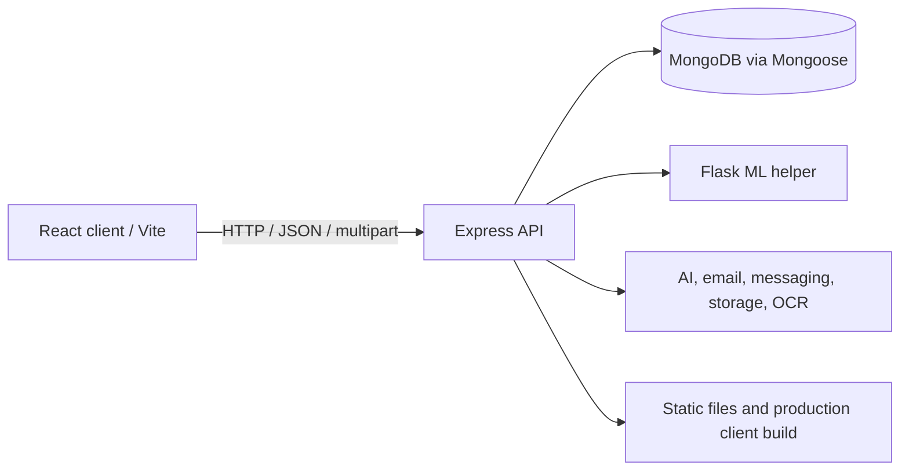

# UltraCare HMS Technical Requirements Document

**Status:** Technical baseline derived from the current repository. Re-check package versions, deployment configuration, and environment settings before release decisions.

## 1. System Context

The application consists of a React single-page application, a Node/Express API, MongoDB persistence through Mongoose, and a Python Flask helper for selected ML workflows. The Node application also integrates with optional third-party services for AI assistance, email, messaging, media storage, OCR, PDF, and QR generation.

## 2. Technology Baseline

- Node.js CommonJS; Express 5; Mongoose; MongoDB.
- `express-session` with `connect-mongo`; CORS configured for local client origins.
- React 19, React Router 7, Vite, Axios, MUI, Lucide, Chart.js.
- Python Flask with scikit-learn and data-processing dependencies for the helper service.
- File handling includes Multer and service-specific storage; inspect per-route limits and storage behavior before extending uploads.
- PDF, QR, and OCR capabilities use existing packages/services. Do not duplicate these utilities without checking current service abstractions.

## 3. Runtime and Configuration

- Backend entry point: `server.js`; default port is `3000` unless `PORT` is set.
- MongoDB connection: `config/db.js`; URI comes from `MONGO_URI`, with a local fallback currently present in code. Keep production credentials outside source control and verify production configuration.
- Client: Vite config is under `client/`; dev server normally uses `5173`.
- Production client: Express serves `client/dist` after the API routes.
- ML helper is started through `services/mlHelperService.js`; helper failures are logged and symptom features may be unavailable.
- Root and client dependencies are separate (`package.json`, `client/package.json`); Python dependencies are listed in `requirements.txt`.
- Enumerate required environment variables from actual `process.env` references and service setup before onboarding/deploying. This repository document intentionally does not invent an environment-variable list.

## 4. Backend Design Requirements

### 4.1 API and middleware

- Feature modules in `routes/` are mounted under `/api` by `server.js`.
- JSON and URL-encoded parsing, CORS, static serving, session middleware, and error handling are configured centrally.
- Authentication/authorization helpers live in `middleware/auth.js`; use the relevant role guard and enforce resource ownership within the route/service.
- Keep request/response semantics stable. Return appropriate status codes and non-sensitive errors; avoid leaking internal stack traces or medical details.
- Ensure any route intentionally accessible without authentication returns only the minimum public information.

### 4.2 Persistence

- MongoDB is accessed through Mongoose models in `models/`.
- Current domain areas include accounts, appointments, prescriptions, care plans/adherence, health records/logs, family/vaccines, allergies, chat, queue, reminders/notifications, reviews, emergency bookings, visit-prep, passport, sharing, and OTP sessions.
- Follow existing schema/index/reference conventions. Validate inputs at API boundaries and model boundaries as appropriate.
- For critical transitions (booking, prescription finalization, queue changes, share-link use), consider concurrency, idempotency, and atomicity. Use transactions only when MongoDB deployment supports them and the use case requires them.

### 4.3 External service boundaries

- Use `services/` abstractions for AI, OCR, storage, email, messaging, report generation, and prescription generation/finalization.
- Design graceful degradation when optional services are unavailable; never silently fabricate a successful external action.
- Add timeouts, validate integration responses, handle retries carefully, and avoid retrying non-idempotent operations without an idempotency strategy.
- Store secrets in environment/configuration providers, not code or client bundles.

### 4.4 Payment integration

- Razorpay is the appointment payment provider; the implementation uses the Node SDK and INR amounts converted to integer paise from the persisted appointment fee.
- `models/Payment.js` is the transaction/refund ledger. A unique appointment reference prevents duplicate ledger records.
- `routes/payments.js` creates/reuses an order only for an authenticated patient's own confirmed appointment, verifies payment signatures, checks gateway payment state, serves payment history, manages admin-reviewed refunds, and processes signed webhooks.
- `services/paymentService.js` owns Razorpay client configuration and constant-time signature checks. `RAZORPAY_KEY_SECRET` and `RAZORPAY_WEBHOOK_SECRET` must never leave the server.
- `server.js` retains the raw JSON request body for webhook verification. Do not mount a JSON parser that consumes/re-serializes the webhook body before signature verification.
- Configure `payment.captured`, `refund.processed`, and `refund.failed` webhook events. Webhook delivery reconciles state when a browser request is interrupted.
- Do not mark an appointment paid based only on browser callback. Preserve idempotency and reconcile duplicate/out-of-order callbacks safely.

## 5. Frontend Design Requirements

- React route registration and role guards are in `client/src/App.jsx`; session identity is managed by `AuthProvider` and `ProtectedRoute`.
- Preserve role-specific navigation and deep links. Client guards improve UX but must not replace backend authorization.
- API calls should handle session credentials consistently with existing Axios usage and backend CORS/session configuration.
- Each async workflow should provide loading, empty, success, and recoverable error states.
- Forms require client-side convenience validation plus authoritative server-side validation.
- Keep layout and component conventions consistent with existing MUI/CSS/theme usage; do not introduce a second design system without need.

## 6. Security, Privacy, and Clinical Safety Requirements

- Check role and ownership for every medical record, appointment, prescription, chat, upload, download, and mutation.
- Protect session cookies in production (secure transport, appropriate `httpOnly`/`sameSite` policy, secret rotation strategy); verify current cookie settings before deployment.
- Remove or replace insecure development defaults in production configuration. Do not log passwords, OTPs, raw tokens, or unnecessary health information.
- Validate upload MIME/type, size, filename, storage path, and access policy; prevent public exposure of private uploads.
- Use high-entropy, scoped, expiring/revocable tokens for sharing and verification, with minimal data exposed.
- Apply rate limiting/abuse controls to authentication, OTP, public token endpoints, and expensive integrations where appropriate.
- Treat AI/ML/OCR results as untrusted suggestions requiring confirmation. Surface uncertainty and preserve clinician review and allergy/interaction warnings.
- Define audit, retention, deletion, consent, backup, and incident-response policies before production use; the repository alone does not establish compliance.

## 7. Performance and Reliability

- Use pagination/limits for potentially growing lists; avoid unbounded queries and loading large files into memory unnecessarily.
- Add database indexes based on actual query patterns and measured explain plans, not speculation.
- Set bounded request and integration timeouts. Avoid blocking the event loop with heavy CPU work; isolate or queue work if usage warrants it.
- Keep startup health meaningful: distinguish API availability, database availability, and optional ML/integration availability.
- Monitor server errors, integration failures, latency, and resource usage without recording sensitive payloads.

## 8. Verification and Commands

- `node server.js` starts the backend (requires MongoDB and configuration; ML helper start may be optional/fail independently).
- `npm run dev --prefix client` runs the client.
- `npm run build --prefix client` builds the SPA.
- `npm run lint --prefix client` lints client code.
- `node scripts/test_patient_profile.js` and `node scripts/test_doctor_profile.js` are documented focused checks; they require a running backend and configured test users.
- Root `npm test` is currently a placeholder, not a real test suite.
- For each change, add/extend the narrowest relevant automated test, especially for authorization and ownership. Do not run destructive tests against non-test data.

## 9. Technical Decisions to Confirm

- Production topology and process manager/container strategy for Node and Python.
- MongoDB deployment/topology, backup/restore, transaction availability, retention, and migration process.
- Supported browser matrix, expected user volume, uptime/latency targets, and file-size limits.
- Secret management, cookie policy, rate limiting, observability, and security scanning tools.
- Whether real video/ambulance dispatch integrations exist; route names alone do not prove external dispatch capability.
